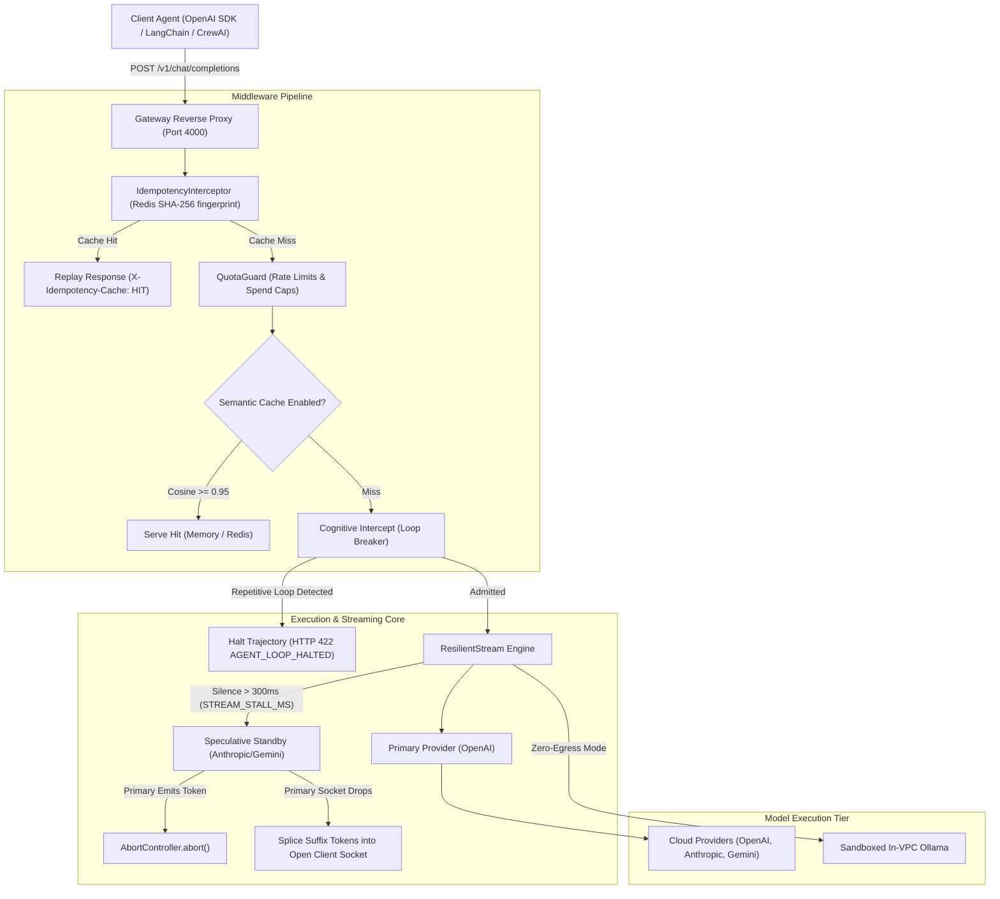

# Selixes AI Gateway

[](https://github.com/selixes/gateway/actions/workflows/ci.yml)
[](./LICENSE)

**Selixes is a self-hosted AI reliability gateway for multi-agent loops that recovers in-flight dropped streams, intercepts runaway tool loops, and caches semantic prompts in your private VPC.**

Production multi-agent workflows delegate execution to centralized LLM providers over stateful Server-Sent Events (SSE) connections. When an upstream provider experiences a silent TCP freeze or 504 timeout midway through generating a complex JSON tool-call schema, standard HTTP retries fail because active streams cannot be safely retried without restarting from token zero and paying double latency. Meanwhile, autonomous agents frequently get trapped in repetitive tool loops, burning hundreds of dollars in minutes unless intercepted statefully at the proxy layer.

---

## Architecture

Selixes acts as an in-line reverse proxy between client agent harnesses and upstream LLM providers, hardening both streaming and non-streaming calls.



---

## ⚡ 5-Minute Quickstart

Get a local gateway instance running with PostgreSQL and Redis in under five minutes.

### 1. Clone & Configure
```bash
git clone https://github.com/selixes/gateway.git
cd gateway
cp .env.example .env
```

### 2. Start Services with Docker Compose
```bash
# Starts PostgreSQL (5432), Redis (6379), and Selixes Gateway (4000)
docker compose up -d
```

### 3. Send Your First Request via curl
```bash
curl -X POST http://localhost:4000/v1/chat/completions \
  -H "Content-Type: application/json" \
  -H "Authorization: Bearer ${GATEWAY_API_KEY}" \
  -d '{
    "model": "gpt-4o",
    "messages": [
      {"role": "user", "content": "Explain stream splicing in one sentence."}
    ]
  }'
```

*(Note: If no cloud API keys are configured, Selixes returns a simulated development response marked with `X-Selixes-Mock: true` so you can verify routing end-to-end without paid accounts).*

---

## 🔄 The 2-Line SDK Swap

Selixes is 100% wire-compatible with the official OpenAI SDK. Swap `baseURL` to route your entire agent stack through the gateway.

### Node.js / TypeScript

```typescript
// Before
import OpenAI from 'openai';
const openai = new OpenAI({ apiKey: process.env.OPENAI_API_KEY });

// After (Routed through Selixes Gateway)
import OpenAI from 'openai';
const openai = new OpenAI({
  baseURL: 'http://localhost:4000/v1', // 1. Point to Selixes
  apiKey: process.env.OPENAI_API_KEY,  // 2. Pass your provider or tenant key
});
```

### Python

```python
# Before
import os
from openai import OpenAI
client = OpenAI(api_key=os.environ.get("OPENAI_API_KEY"))

# After (Routed through Selixes Gateway)
import os
from openai import OpenAI
client = OpenAI(
    base_url="http://localhost:4000/v1", # 1. Point to Selixes
    api_key=os.environ.get("OPENAI_API_KEY")
)
```

---

## Core Features (Source Verified)

Every feature listed below is fully implemented and tested in this repository:

* **Resilient Mid-Flight Stream Splicing:** Recovers active Server-Sent Events (SSE) connections when upstream providers terminate sockets midway through generating tool-call schemas. Spliced tokens stream directly into the active client socket with zero duplicate generation.  
  *Source:* [`apps/api/src/gateway/streaming/resilient-stream.ts`](./apps/api/src/gateway/streaming/resilient-stream.ts) | Test: [`apps/api/src/gateway/stream-splicing-claim.spec.ts`](./apps/api/src/gateway/stream-splicing-claim.spec.ts)

* **Speculative Standby Pre-Warming & Cancellation:** Starts background standby dispatch if upstream pauses for >300ms. If the primary model resumes, the standby stream is immediately aborted via `AbortController`, preventing orphan token spend.  
  *Source:* [`apps/api/src/gateway/streaming/resilient-stream.ts:196-234`](./apps/api/src/gateway/streaming/resilient-stream.ts#L196-L234)

* **Cognitive Intercept Loop Breaker (`422 AGENT_LOOP_HALTED`):** Sliding-window trajectory engine inspects rolling SHA-256 digests of tool calls, arguments, and return values. When repetitive action loops are detected, the gateway terminates the run with `HTTP 422 AGENT_LOOP_HALTED` instead of returning 429s that cause client retry storms.  
  *Source:* [`apps/api/src/gateway/gateway.service.ts:498`](./apps/api/src/gateway/gateway.service.ts#L498), [`apps/api/src/gateway/immune-system.service.ts`](./apps/api/src/gateway/immune-system.service.ts) | Benchmark: [`scripts/bench_loop_detection.js`](./scripts/bench_loop_detection.js) | Test: [`apps/api/src/gateway/agent-loop-halted-422.spec.ts`](./apps/api/src/gateway/agent-loop-halted-422.spec.ts)

* **Request Idempotency & Replay:** Inspects `Idempotency-Key` or `X-Idempotency-Key` headers, fingerprints payloads into Redis for 24 hours, and replays cached responses on identical requests with `X-Idempotency-Cache: HIT`.  
  *Source:* [`apps/api/src/gateway/idempotency.interceptor.ts`](./apps/api/src/gateway/idempotency.interceptor.ts) | Test: [`apps/api/src/gateway/idempotency.interceptor.spec.ts`](./apps/api/src/gateway/idempotency.interceptor.spec.ts)

* **Local In-Process ONNX Semantic Caching:** Embeds incoming prompts using local `Xenova/all-MiniLM-L6-v2` ONNX models without cloud embedding API egress. Supports LRU memory, Redis, and Pinecone backends with a 0.95 similarity threshold and opt-in cross-encoder reranking.  
  *Source:* [`apps/api/src/gateway/semantic-cache.service.ts`](./apps/api/src/gateway/semantic-cache.service.ts) | Test: [`apps/api/src/gateway/semantic-cache.service.spec.ts`](./apps/api/src/gateway/semantic-cache.service.spec.ts)

* **Time-Travel Trajectory Rollback:** Captures multi-turn trajectory snapshots backed by Redis with in-memory fallback, allowing agent workflows to roll back state to turn $N$ upon failure.  
  *Source:* [`apps/api/src/gateway/time-travel-rollback.service.ts`](./apps/api/src/gateway/time-travel-rollback.service.ts) | Test: [`apps/api/src/gateway/time-travel-claim.spec.ts`](./apps/api/src/gateway/time-travel-claim.spec.ts)

* **Streaming PII Masking Pipeline:** Look-ahead window buffering detects and redacts SSNs, credit cards, IBANs, and passports across streaming chunk boundaries before token persistence.  
  *Source:* [`apps/api/src/gateway/streaming/stream.pipeline.ts`](./apps/api/src/gateway/streaming/stream.pipeline.ts)

* **Zero-Egress In-VPC Deployment:** Fully operational offline mode routing requests through sandboxed local Ollama instances inside the private VPC network.  
  *Source:* [`docker-compose.zero-egress.yml`](./docker-compose.zero-egress.yml)

---

## Reliability Behaviors Explained

### 1. The Stream Stall Watchdog (`STREAM_STALL_MS`)
Standard HTTP gateways use total request timeouts (e.g. 30s). In streaming SSE, an upstream provider can maintain an open TCP connection while silently stalling for 10+ seconds.
* Selixes monitors the interval between individual delta chunks using `STREAM_STALL_MS` (default: **300ms**).
* If silence exceeds 300ms, a speculative standby stream is launched in the background to pre-warm TLS connections and prompt evaluation on the fallback provider.

### 2. Standby Cancellation vs. Dynamic Splicing
* **Happy Path Recovery:** If the primary provider emits another token before the standby begins outputting, the speculative standby is immediately cancelled via `speculativeAbortController.abort()`. Zero duplicate tokens are billed.
* **Failure Path Splicing:** If the primary connection resets or times out, the gateway adopts the speculative standby. The standby is supplied with the prompt plus the already-delivered prefix tokens (seam continuation). The downstream client's TCP socket never resets, and generation continues uninterrupted.

### 3. Loop Guard: 422 vs 429
When an autonomous agent gets stuck repeating tool executions (e.g., calling `read_file` with the same path after a failure):
* Traditional rate limiters return HTTP 429 (Too Many Requests), which client SDKs treat as transient and immediately retry with exponential backoff.
* Selixes recognizes semantic tool loops and returns **`HTTP 422 Unprocessable Entity`** with error code `AGENT_LOOP_HALTED`. This explicitly notifies agent orchestrators (LangChain, AutoGen, CrewAI) that the action is syntactically invalid, breaking the loop permanently.
* **In-Process Performance:** The rolling trajectory evaluator executes in microseconds without database queries or network roundtrips. Run [`node scripts/bench_loop_detection.js`](./scripts/bench_loop_detection.js) to measure loop detection across 1,000 multi-turn iterations on your hardware (baseline: 22.30 µs median on a 2-vCPU verification server; 8.75 µs on Oryon aarch64).

### 4. Idempotency Interceptor
* Clients supply an `Idempotency-Key: <UUID>` header.
* The gateway computes an SHA-256 fingerprint: `sha256(tenantId + ":" + idempotencyKey + ":" + sha256(requestBody))`.
* Concurrent duplicate requests are locked in Redis. If a response was already completed, it is returned directly from cache with header `X-Idempotency-Cache: HIT`.

---

## Reproducible Benchmarks

To independently reproduce the semantic cache evaluation matrix across held-out datasets (QQP duplicates, PAWS non-paraphrases, GSM8k):

```bash
# Run multi-config benchmark matrix
node scripts/run_config_matrix.js
```

### Empirical Results Across Configurations:
* **Config A (Single-Stage 0.95 Threshold):** Fast single-pass cosine similarity with zero cross-encoder overhead. Minimizes false-positive semantic matches on non-paraphrases.
* **Config C & D (Two-Stage with Cross-Encoder):** Uses ONNX `ms-marco-MiniLM-L-6-v2` cross-encoder reranking (~400MB memory overhead) to verify semantic equivalence before admitting cache hits.

For full test setup, hardware details, and latency breakdown, see [`BENCHMARK_REAL.md`](./BENCHMARK_REAL.md).

---

## Production Hardening

When deploying Selixes in production (`NODE_ENV=production`), the gateway enforces strict security boundaries:

1. **Startup Secrets Validator:** On boot, [`apps/api/src/common/config/production-secrets.validator.ts`](./apps/api/src/common/config/production-secrets.validator.ts) executes `validateProductionSecrets()`. The application will throw an unhandled exception and halt startup if:
   - `DATABASE_URL` contains known default development passwords (e.g. `password`, `dev`, `changeme`, `selixes`, `akra`) or is shorter than 16 characters.
   - `REPLAY_CRYPTO_SECRET` is unset, shorter than 32 characters, or contains placeholders (`REPLACE`, `default`, `selixes-vault`).
   - `REDIS_PASSWORD` is unset in production.
   - `GATEWAY_TEST_MODE=true` (outage simulation is strictly forbidden in production).  
   *Source:* [`apps/api/src/common/config/production-secrets.validator.ts`](./apps/api/src/common/config/production-secrets.validator.ts) | Test: [`apps/api/src/common/config/production-secrets.validator.spec.ts`](./apps/api/src/common/config/production-secrets.validator.spec.ts)
2. **Authenticated Redis:** Production compose enforces password authentication via `redis-server --requirepass ${REDIS_PASSWORD:?err}`.
3. **Production Exception Filter:** Suppresses internal stack traces and database error reflections, returning clean structured error codes.  
   *Source:* [`apps/api/src/common/filters/production-exception.filter.ts`](./apps/api/src/common/filters/production-exception.filter.ts) | Test: [`apps/api/src/common/filters/production-exception.filter.spec.ts`](./apps/api/src/common/filters/production-exception.filter.spec.ts)

---

## Configuration Reference

| Variable | Default | Required in Prod? | Description |
| :--- | :--- | :---: | :--- |
| `NODE_ENV` | `development` | Yes | Environment mode (`development`, `production`). |
| `PORT` | `4000` | No | Gateway API listening port. |
| `DATABASE_URL` | - | **Yes** | PostgreSQL connection string. Default passwords blocked in prod. |
| `REDIS_HOST` | `localhost` | No | Redis host for idempotency and quota management. |
| `REDIS_PASSWORD` | `""` | **Yes (Prod)** | Enforced via `--requirepass` in production. |
| `STREAM_STALL_MS` | `300` | No | Upstream token silence timeout before speculative standby failover. |
| `SEMANTIC_CACHE_ENABLED` | `false` | No | Master toggle for semantic prompt caching. |
| `SEMANTIC_CACHE_THRESHOLD`| `0.95` | No | Cosine similarity threshold for semantic hits. |
| `SEMANTIC_CACHE_CROSS_ENCODER`| `false` | No | Enables Stage 2 ONNX cross-encoder reranker (~400MB memory). |
| `REPLAY_CRYPTO_SECRET` | - | **Yes** | 32-byte secret for AES-256 GCM telemetry encryption. |
| `GATEWAY_TEST_MODE` | `false` | No | Outage injection toggle. Must be `false` in production. |

For the complete list of all 25+ parameters, see [`docs/configuration.md`](./docs/configuration.md).

---

## Roadmap

- [ ] Distributed streaming bidirectional cross-encoder evaluation
- [ ] Helm chart and Kubernetes Operator for multi-cluster enterprise deployments
- [ ] Dynamic cross-tenant token quota reservation pooling
- [ ] Native Model Context Protocol (MCP) tool-call interceptors

---

## License & Contributing

* **License:** Distributed under the [MIT License](./LICENSE).
* **Contributing:** We welcome contributions! Please review our [Contributing Guide](./CONTRIBUTING.md) and [Architecture Guide](./docs/architecture.md).
* **Security:** For responsible vulnerability disclosure, see [SECURITY.md](./SECURITY.md).
