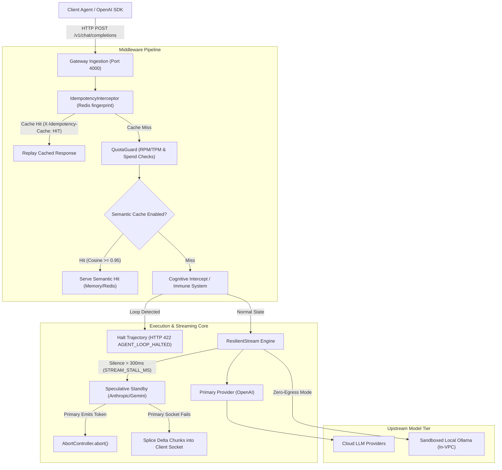

# Selixes Gateway Architecture

Selixes is architected as an in-line, sovereign reliability gateway deployed directly between your agent application and LLM providers. It operates as an HTTP reverse proxy that intercepts and hardens streaming and non-streaming model invocations.

---

## High-Level Request Pipeline

---

## Core Architectural Stages

### 1. Ingestion & Edge Controls
* **OpenAI SDK Drop-in Compatibility:** Listens on `/v1/chat/completions` and `/v1/models`, exposing an identical API interface to OpenAI.
* **Payload Guards:** Enforces a 1MB payload ceiling and captures raw body bytes for webhook verification.
* **Split CORS Policy:** Permits server-to-server calls with null origin while strictly enforcing domain whitelisting for web clients (`apps/web`).

### 2. Idempotency & Deduplication
* **Header Inspection:** Reads standard `Idempotency-Key` or `X-Idempotency-Key` headers ([`idempotency.interceptor.ts`](../apps/api/src/gateway/idempotency.interceptor.ts)).
* **Fingerprinting:** Computes a SHA-256 hash of `tenantKey:idempotencyKey:sha256(payload)`.
* **Atomic Redis Storage:** If the fingerprint exists, returns the cached response with `X-Idempotency-Cache: HIT`. Otherwise, executes the generation, caches the result for 24 hours, and emits `X-Idempotency-Cache: MISS`.

### 3. In-Process ONNX Semantic Caching
* **Local Embeddings:** Runs `Xenova/all-MiniLM-L6-v2` directly inside the Node.js process using ONNX runtime. No prompt text leaves the container for embedding generation ([`semantic-cache.service.ts`](../apps/api/src/gateway/semantic-cache.service.ts)).
* **Calibrated Similarity Threshold:** Evaluates cosine similarity with a single-stage default threshold of **0.95** (calibrated to avoid false-positive semantic drift).
* **Optional Two-Stage Cross-Encoder:** If `SEMANTIC_CACHE_CROSS_ENCODER=true` is enabled, pairs candidate matches with a secondary reranker (`Xenova/ms-marco-MiniLM-L-6-v2`) before admitting the hit.
* **Storage Backends:** Supports fast in-memory LRU (`memory`), shared Redis (`redis`), or Pinecone vector index (`pinecone`).
* **PII Safety:** Automatically skips semantic caching if sensitive patterns (credit cards, SSNs) are detected in the prompt (`SEMANTIC_CACHE_SKIP_ON_PII=true`).

### 4. Resilient Streaming & Mid-Flight Splicing
* **Stall Watchdog (`STREAM_STALL_MS`):** When streaming Server-Sent Events (SSE), standard proxies freeze when upstream sockets stall. Selixes starts a 300ms timer ([`resilient-stream.ts:171`](../apps/api/src/gateway/streaming/resilient-stream.ts#L171)).
* **Speculative Standby Pre-Warming:** If 300ms passes without a token, the engine speculatively dispatches prefix continuation to the standby provider in the background.
* **Standby Cancellation:** If the primary emits a token, the speculative standby is aborted via `AbortController` ([`resilient-stream.ts:231`](../apps/api/src/gateway/streaming/resilient-stream.ts#L231)).
* **In-Flight Seam Splicing:** If the primary upstream socket drops abruptly (e.g. at token 180 of a complex JSON tool call), the engine seamlessly splices generation from the pre-warmed standby into the open client TCP socket without resetting the connection.
* **Zero Duplicate Output:** The standby receives the prompt and the delivered prefix tokens, ensuring output generation continues from the exact character offset.

### 5. Trajectory Loop Interception (`422 AGENT_LOOP_HALTED`)
* **Sliding Window Hashing:** Maintains a rolling window of recent tool names, argument payloads, and results ([`immune-system.service.ts`](../apps/api/src/gateway/immune-system.service.ts)).
* **Repetitive Action Guard:** When an autonomous agent calls the exact same tool with identical arguments 3 times consecutively, the gateway terminates the run.
* **422 Response vs 429 Retry Storms:** Instead of returning HTTP 429 (which triggers client retry loops and burns tokens), Selixes returns `HTTP 422 Unprocessable Entity` with `{ error: { code: 'AGENT_LOOP_HALTED', message: ... } }` ([`agent-loop-halted-422.spec.ts`](../apps/api/src/gateway/agent-loop-halted-422.spec.ts)).
